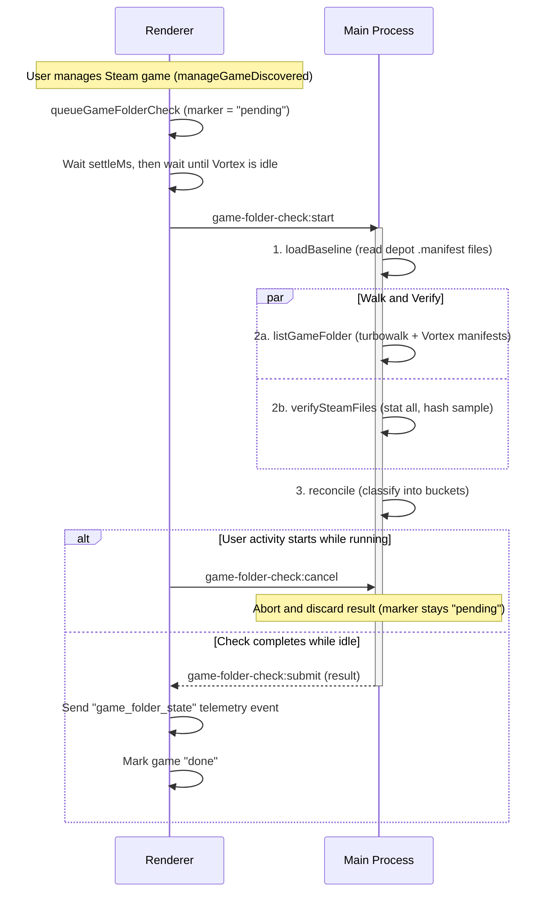
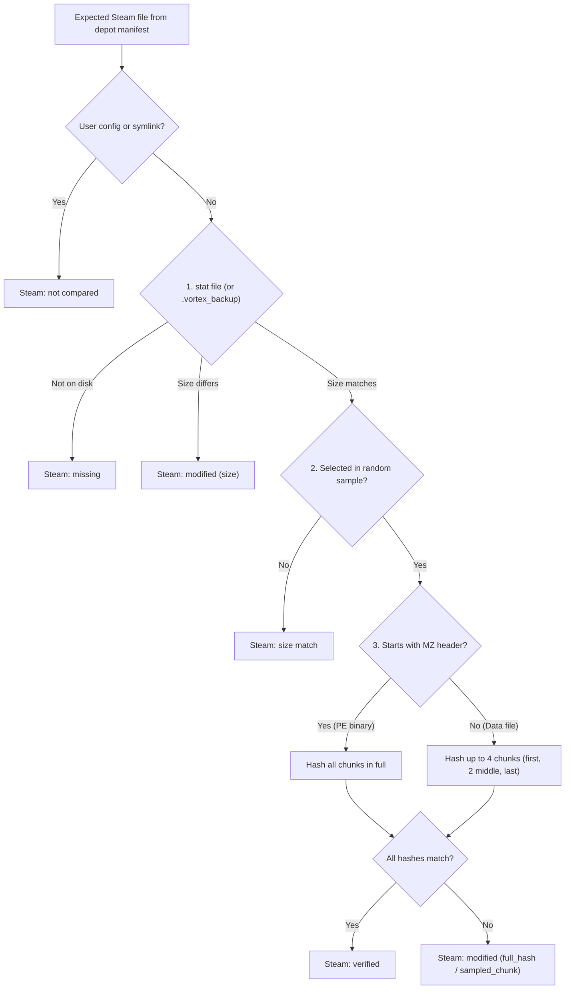

# Game Folder Check

When a user starts managing a Steam game in Vortex, their game folder might
already be "dirty"—containing manually installed mods, modified executables, or
missing vanilla files. The Game Folder Check scans the game directory in the
background once per game and sends a single `game_folder_state` telemetry event
summarising what it found.

The check is completely read-only and invisible to the user. It is controlled by
the `vortex-game-folder-check` feature flag
([MOD-80](https://linear.app/nexus-mods/issue/MOD-80/measure-dirty-steam-game-folders)).

## Lifecycle and Flow



Work is split between the renderer and main processes:

- **Renderer** decides _when_ to run the check (since Vortex's activity state
  and running tools live in the renderer store) and _sends_ the telemetry event
  at the end (since Nexus OAuth authentication and the v3 API client live in
  `src/renderer/src/extensions/nexus_integration/nexusV3Client.ts`).
- **Main** performs all disk I/O and hashing, then returns the result over the
  `game-folder-check:submit` `CallbackChannels` entry (following the same
  pattern as `download:resolve`).

### When It Runs

The check runs once per game, triggered when the user first manages a Steam
game:

1. **Queueing:** `queueGameFolderCheck` runs alongside `emitGameManaged` in
   `src/renderer/src/extensions/profile_management/index.ts`, which every
   path for managing a game passes through. If the game hasn't been checked yet,
   the feature flag is enabled, and the game meets all preconditions, Vortex
   writes a `pending` marker with a `managedAt` timestamp.
2. **Preconditions (Gates):** Uses the same gates as `store_game_version`,
   restricted to Steam on Windows:
    - Running on Windows
    - Telemetry enabled and user logged in
    - Game has a numeric Nexus `GameId`
    - Game was discovered via Steam
3. **Waiting for idle:** The scheduler waits for a settle period (`settleMs`
   after `managedAt`) and then waits until Vortex is idle—meaning no `mods`,
   `dependencies`, or `plugins` activity in `session.base.activity`, and nothing
   in `session.base.toolsRunning`.
4. **Cancellation on activity:** If any of those activities or tools start while
   a check is in progress, the renderer sends `game-folder-check:cancel`. Main
   aborts the check and discards any partial or completed result so nothing is
   submitted. The marker remains `pending` and the scheduler retries the next
   time Vortex is idle.

Markers are persisted in `persistent.analyticsTelemetry.gameFolderChecks` (keyed
by `VortexGameId`), so a pending check survives app restarts. If a check errors
out or telemetry submission fails, the marker stays `pending` and is retried on
the next session rather than looping in the current one.

Main runs at most one check at a time and tracks at most one active job per
game. If a second `start` request arrives for the same game (for instance, after
a renderer reload), it attaches to the already-running job.

## How the Check Works

When main receives `game-folder-check:start`, it runs three phases: loading the
Steam baseline, walking the game folder, and verifying Steam's files.

### 1. Loading the Steam Baseline

`loadBaseline` reads the game's Steam `.acf` manifest to find its
`InstalledDepots` and the active manifest ID for each depot (ignoring shared
redistributable depots and older `.manifest` files left in the cache). It then
parses `<steam>/depotcache/<depot>_<manifest>.manifest`.

Each depot manifest provides the expected file list, file sizes, full-file SHA1
hashes, and chunk metadata (SHA1, offset, and size for chunks up to 1 MiB).

If Vortex cannot load a complete baseline (for example, if Steam is mid-update
or a `.manifest` file is missing), it cannot tell vanilla Steam files apart from
unknown files, so the check stops early and reports status `no_baseline`.

### 2. Walking the Game Folder

`listGameFolder` walks the game directory using `turbowalk` and reads any
`vortex.deployment*.json` manifests it encounters.

`turbowalk` queries file names and sizes in batches via `NtQueryDirectoryFile`
(taking ~3.3 s for RimWorld's 217k files, compared to ~26 s with `readdir` +
`lstat`). The check compares against `turbowalk`'s `length` field (actual
content length) rather than `size` (allocated size on disk, which would make
almost every file look modified).

Because directory walking is fast compared to file hashing, the walk always runs
to completion.

### 3. Verifying Steam Files

In parallel with the folder walk, `verifySteamFiles` checks the files listed in
the depot manifests in three steps:



1. **Size check:** Calls `stat` on every expected Steam file (checking its
   `.vortex_backup` first if one exists), 16 files at a time. Any file whose
   size differs from the manifest is immediately marked modified (`detected_by:
'size'`).
2. **Sampling:** From the files whose sizes match, picks a random sample to
   hash: up to `hashSampleExecutables` `.exe`/`.dll` files first, followed by up
   to `hashSampleFiles` other files. Any remaining size-matched files are
   recorded as `size_matched`.
3. **Chunk hashing:** Hashes up to `hashConcurrency` sampled files at a time:
    - **Data files:** Hashes up to four chunks per file—the first, the last, and
      two from the middle.
    - **Executables:** Any file whose first chunk starts with the `MZ` header (a
      Windows PE binary, regardless of file extension) is hashed in full, stopping
      at the first mismatched chunk, because binary patches can modify bytes
      anywhere in the file.

Before opening each file and before reading each chunk, the verifier checks
`maxDurationMs` (measured from the start of the check) and `maxBytes`. Hitting
either limit stops verification with status `aborted` (`reason: 'max_duration'`
or `'max_bytes'`). Unreached files are counted as `unchecked`, and the partial
verification result is still sent.

#### Why We Sample (Windows Defender Overhead)

On a cold OS file cache, Windows Defender scans a file the first time it is
opened for reading—adding ~5 ms per data file and 16–841 ms per executable,
charged against `node.exe`. That overhead scales with the _number of files
opened_, not their byte size. Calling `stat` by path does not trigger a scan,
whereas opening and hashing every file in a large game takes several minutes.

Checking every file's size via `stat` and only opening a bounded sample keeps
worst-case runtimes reasonable (e.g. ~39 s cold for Bannerlord with default
limits). Executables are sampled before data files so that if a check hits a
time or byte limit, the highest-signal files have already been verified.

To measure how much modification our sampling misses, a configurable percentage
of checks (`fullVerifyPercent`, default 2%) performs a full verification—hashing
every chunk of every size-matched Steam file—while still recording whether the
normal sample would have missed the change:

- `file_sample_missed`: The modified file was not selected by the random file
  sample.
- `sample_missed`: The file was selected, but the modified bytes fell outside
  the four sampled chunks.

#### Why Hashing Runs on the Main Thread

Hashing runs directly in the main process, reading and hashing one chunk (at
most 1 MiB) per `await`, which blocks the main event loop for no more than
~1.5 ms at a time. Because `turbowalk` already runs on its own native thread and
file reads happen on Node's libuv thread pool, moving SHA1 hashing to a worker
thread wouldn't make the check faster—the bottleneck is disk I/O and Windows
Defender, not CPU hashing.

## File Classification

Once the walk and verification finish, `reconcile` assigns every file to one of
nine buckets:

| Bucket              | Meaning                                                                                                                    |
| ------------------- | -------------------------------------------------------------------------------------------------------------------------- |
| Steam: verified     | Hashed against the depot manifest and matches                                                                              |
| Steam: size match   | Matches the manifest size, but wasn't selected for hashing                                                                 |
| Steam: modified     | Size or hash differs from the manifest. Records how it was caught: `size`, `sampled_chunk`, or `full_hash`                 |
| Steam: missing      | Listed in the depot manifest, but not present on disk                                                                      |
| Steam: unreadable   | Present on disk, but couldn't be opened or read                                                                            |
| Steam: not compared | Marked in the depot manifest as a user config or symlink (Steam's own "Verify integrity" skips these too)                  |
| Steam: unchecked    | Not reached before a time or byte limit stopped verification                                                               |
| Unknown             | Not in Steam's manifest and not deployed by Vortex. Tagged `in_vortex_folder` if located inside a directory Vortex created |
| Vortex              | Deployed mod files, `vortex.deployment*.json` manifests, and folder markers. Tracks deployed files modified since deploy   |

> [!NOTE]
> Unknown files inside Vortex-created directories (`in_vortex_folder`) are
> typically generated at runtime by mods (logs, caches, config files, databases).
> Because Vortex cannot reliably distinguish mod runtime output from files a user
> dropped in manually, they are still reported and tagged so game-specific noise
> can be filtered out in ClickHouse rather than hardcoded in the client.

### Reconstructing State After a Vortex Deploy

Ideally, the check runs before the user deploys any mods. However, if a deploy
happens before Vortex becomes idle, the check reconstructs what the folder
looked like _before_ Vortex deployed by inspecting backups and deployment
manifests:

- **Steam path with a `.vortex_backup`:** When Vortex deploys over an existing
  file, it renames the original to `<file>.vortex_backup` (`backUpGameFile` in
  `src/renderer/src/extensions/mod_management/LinkingDeployment.ts`). The check
  verifies the backup file instead of the deployed mod file on disk.
- **Steam path deployed by Vortex, with no backup:** If Vortex deployed a file
  at a Steam path without creating a backup, the original Steam file wasn't on
  disk when deployment ran—so the Steam file is counted as **Steam: missing**.
- **Non-Steam path with a `.vortex_backup`:** A backup at a path not in Steam's
  manifest means a non-Steam file was already there before Vortex overwrote it,
  so it is counted as **Unknown**.
- **Files listed in `vortex.deployment*.json`:** Counted under **Vortex**.

Results reconstructed this way have `deployed_before_check: true`. Any other
changes made between managing the game and running the check (for example,
launching the game and generating save or config files) appear as if they were
already present when the game was managed.

## Telemetry Event (`game_folder_state`)

The `game_folder_state` (v1) schema is defined in
`packages/nexus-api-v3/src/eventTypes.ts`. Main returns a camelCase
`GameFolderCheckResult` (`src/shared/src/types/gameFolderCheck.ts`), which the
renderer maps to snake_case right before sending (`payload.ts`).

The event payload includes:

- **Status and reason:** Whether the check completed, lacked a baseline, or was
  aborted (see table below).
- **Bucket totals:** File counts and byte totals for each bucket.
- **Steam metadata:** App ID, build ID, depot IDs, and manifest IDs.
- **Timestamps:** `managed_at`, Steam's `LastUpdated`, install folder creation
  time, and depot manifest creation times.
- **Performance metrics:** Total duration, files walked, and bytes read.
- **File lists (`files`):**
    - Every modified or missing Steam file, including `detected_by` and
      `from_backup` where applicable.
    - Up to `maxUnknownPaths` unknown files (sampled at random and sorted), with
      `unknown_truncated: true` if there were more.
    - `unknown_by_folder`: Total count of unknown files grouped by their top two
      directory levels.

All file paths in the payload are relative to the game folder using `/`
separators. Absolute local paths (such as the Steam library path or OS username)
never leave the machine.

### Statuses and Reasons

| `status`      | `reason`                                                                                              |
| ------------- | ----------------------------------------------------------------------------------------------------- |
| `checked`     | `null`. `verification` carries its own status: `checked`, or `aborted` (`max_duration` / `max_bytes`) |
| `no_baseline` | `steam_updating`, `no_depots`, `manifest_missing`, `manifest_unreadable`, or `filenames_encrypted`    |
| `aborted`     | `steam_changed` (the `.acf` modification time changed mid-check) or `walk_failed`                     |

## Feature Flag and Configuration

The check is controlled by `vortex-game-folder-check` in
`src/shared/src/types/flags.ts`. Enabling the flag turns the check on. Its
optional `config` JSON payload can override any default in
`src/renderer/src/extensions/analytics/gameFolderCheck/config.ts` without
requiring a client release:

| Key                     | Default | Description                                                                 |
| ----------------------- | ------- | --------------------------------------------------------------------------- |
| `settleMs`              | 30000   | Delay (ms) after a game is managed before the check can start               |
| `maxDurationMs`         | 60000   | Maximum time (ms) before verification stops                                 |
| `maxBytes`              | 3 GiB   | Maximum bytes read before verification stops                                |
| `hashConcurrency`       | 4       | Number of files hashed concurrently                                         |
| `hashSampleExecutables` | 1000    | Maximum `.exe` and `.dll` files sampled for hashing per check               |
| `hashSampleFiles`       | 2000    | Maximum non-executable files sampled for hashing per check                  |
| `maxUnknownPaths`       | 2000    | Maximum unknown file paths included in a single event                       |
| `fullVerifyPercent`     | 2       | Percentage of checks that hash every chunk of every size-matched Steam file |

Example flag config override:

```json
{ "maxDurationMs": 30000, "hashConcurrency": 2 }
```

## Running a Check Manually (Dev Builds)

In development builds, each game card on the **Games** page includes a **Check
Game Folder** action (whether the game is managed or not) for any Steam-installed
game.

Running it manually:

- Bypasses the feature flag, telemetry gates, persistence marker, settle delay,
  and idle wait.
- Does **not** send a telemetry event.
- Uses the feature flag's config limits if the flag is enabled, or the default
  limits otherwise.
- Writes a full JSON report to `game-folder-check/<gameId>-<timestamp>.json` in
  Vortex's temp directory (`%APPDATA%\@vortex\main\temp` in dev) and reveals the
  file in Explorer. The report contains both the telemetry payload that would
  have been sent and the complete per-file classification list.

> [!TIP]
> In production, the check runs once per game on a cold OS file cache. To
> reproduce realistic Windows Defender and disk timings locally, clear the
> Windows standby list before each run using Sysinternals RAMMap (**Empty → Empty
> Standby List**).

## Key Files

Main process (`src/main/src/gameFolderCheck/`):

- `depotManifest.ts` - Parses Steam `.manifest` protobuf sections
- `baseline.ts` - Builds the expected file list for installed depots, or returns a `no_baseline` reason
- `listing.ts` - Walks the game folder with `turbowalk` and reads Vortex deployment manifests
- `verify.ts` - Performs `stat` size checks, file sampling, chunk hashing, and limit enforcement
- `reconcile.ts` - Classifies every file into a bucket and selects file paths for the payload
- `run.ts` - Orchestrates a single check: loads baseline, then runs listing and verification in parallel
- `service.ts` - Enforces single-check concurrency, deduplicates per-game jobs, and handles cancellation
- `ipc.ts` - Registers `game-folder-check:*` IPC handlers and writes the manual dev report

Renderer process (`src/renderer/src/extensions/analytics/gameFolderCheck/`):

- `scheduler.ts` - Evaluates gates, manages persistent markers, waits for settle/idle, and cancels on user activity
- `steamInput.ts` - Locates the game's Steam installation and builds the input payload for main
- `submit.ts` - Sends the `game_folder_state` telemetry event and marks the check `done`
- `payload.ts` - Maps main's `GameFolderCheckResult` to the snake_case telemetry event schema
- `config.ts` - Defines default limits and merges feature-flag config overrides
- `index.ts` - Wires up startup hooks and registers the dev-only "Check Game Folder" action

Shared types and schemas:

- `src/shared/src/types/gameFolderCheck.ts` - Input, limit, and result types shared between main and renderer
- `src/shared/src/types/ipc.ts` - `game-folder-check:*` IPC channel definitions
- `packages/nexus-api-v3/src/eventTypes.ts` - `game_folder_state` telemetry event schema
